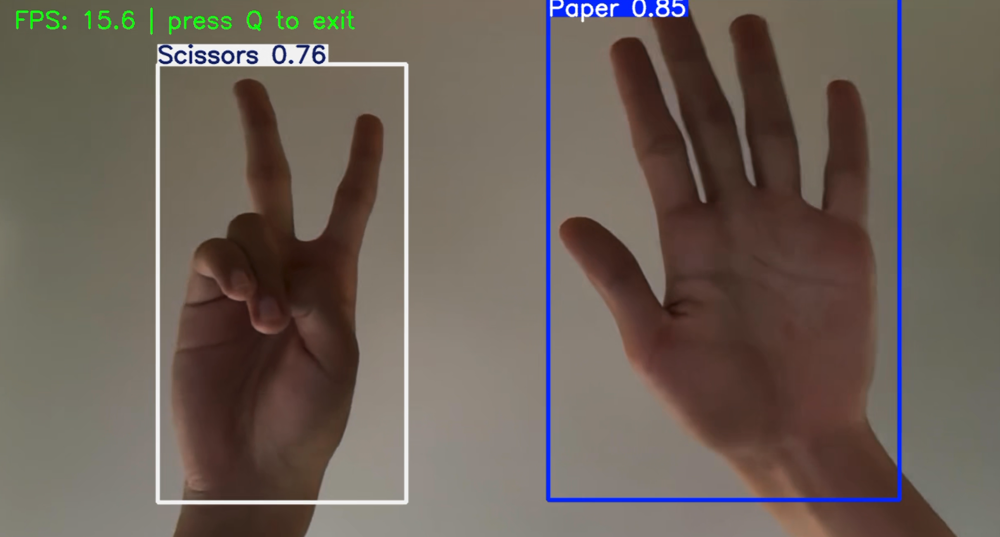
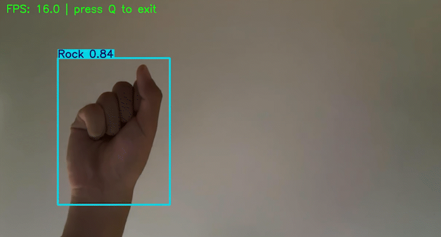

# Project 3: Rock-Paper-Scissors Gesture Detection

English | [简体中文](README_zh.md)


A YOLO11n object-detection project for rock, paper and scissors hand gestures.

## Overview

The project trains an Ultralytics YOLO11n detector to recognize Scissors, Rock and Paper gestures in webcam images in real time.

## Dataset

The dataset is version v11 (YOLOv8n-100epochs) of [rock-paper-scissors-sxsw](https://universe.roboflow.com/roboflow-58fyf/rock-paper-scissors-sxsw) on Roboflow, containing **15,874 images** created by contributors to the SXSW 2023 “World's Largest Game of Rock, Paper, Scissors” challenge.

### Preprocessing
- Automatic rotation to correct EXIF orientation
- Resize to 640×640 using stretch-to-fit

### Augmentation (7 Versions per Original Image)
- Horizontal flip with 50% probability
- Random rotation from -12° to +12°
- Random shear from -2° to +2°
- Brightness adjustment from -25% to +25%
- Exposure adjustment from -25% to +25%
- Random Gaussian blur from 0 to 1.5 pixels
- Salt-and-pepper noise on 1% of pixels

### Classes
- Paper
- Rock
- Scissors

## Requirements

- Python 3.12+
- PyTorch 2.7+
- CUDA-compatible GPU for training; optional for inference
- ultralytics
- opencv-python
- roboflow for dataset downloading

## File Structure

```
project3/
├── README.md                    # 本文件
├── console.md                   # 控制台运行日志
├── download_data.py             # 从 Roboflow 下载数据集
├── train.py                     # 训练模型
├── evaluate.py                  # 在验证集上评估
├── test.py                      # 在测试集上评估
├── predict.py                   # 单张图片推理
├── detect.py                    # 实时摄像头检测
├── yolo11n.pt                   # YOLO11n 预训练权重
├── yolo26n.pt                   # YOLO26n 预训练权重
├── result.png                   # 推理结果截图
├── result.gif                   # 实时检测动图
├── result.mp4                   # 实时检测录屏
├── rock-paper-scissors-11/      # 数据集目录
│   ├── data.yaml                # 数据集配置文件
│   ├── train/                   # 训练集（图片 + 标签）
│   ├── valid/                   # 验证集
│   └── test/                    # 测试集
└── runs/
    └── detect/
        ├── train/               # 训练输出（权重、指标曲线、训练图片）
        ├── val/                 # 验证集评估输出
        └── val-2/               # 测试集评估输出
```

## Usage

### 1. Download the Dataset

```bash
python download_data.py
```

A valid Roboflow API Key is required (included in the script in the original setup).

### 2. Train the Model

```bash
python train.py
```

Training parameters:
- Model: `yolo11n.pt`
- Input size: 640×640
- Epochs：50
- Batch size：16
- Workers：8
- Optimizer: AdamW
- Device: CUDA

Training took approximately **3.07 hours** (50 epochs, RTX 5060 Laptop GPU).

### 3. Evaluate the Model

```bash
# 验证集评估
python evaluate.py

# 测试集评估
python test.py
```

**Validation results:**
| Class     | Images | Instances | P     | R     | mAP50 | mAP50-95 |
|-----------|--------|-----------|-------|-------|-------|----------|
| all       | 588    | 406       | 0.942 | 0.891 | 0.940 | 0.697    |
| Paper     | 134    | 141       | 0.934 | 0.894 | 0.936 | 0.690    |
| Rock      | 125    | 147       | 0.949 | 0.898 | 0.943 | 0.689    |
| Scissors  | 114    | 118       | 0.944 | 0.881 | 0.940 | 0.714    |

**Test results:**
| Class     | Images | Instances | P     | R     | mAP50 | mAP50-95 |
|-----------|--------|-----------|-------|-------|-------|----------|
| all       | 320    | 210       | 0.898 | 0.920 | 0.934 | 0.693    |
| Paper     | 72     | 72        | 0.868 | 0.861 | 0.904 | 0.630    |
| Rock      | 63     | 72        | 0.938 | 0.944 | 0.951 | 0.715    |
| Scissors  | 64     | 66        | 0.887 | 0.953 | 0.947 | 0.734    |

### 4. Single-Image Prediction

```bash
python predict.py
```

The default input is `my_hand.jpg`; detection results are saved under `runs/detect/`.

### 5. Real-Time Webcam Detection

```bash
python detect.py
```

- Opens the system webcam for real-time detection
- Displays FPS in the window
- Press `Q` to quit

## Inference Examples

The project directory contains these inference outputs:

| File | Description |
|------|------|
| `result.png` | Single-image inference screenshot |
| `result.gif` | Real-time webcam animation cycling through the gestures |
| `result.mp4` | Full real-time detection recording |





## Training Logs

See `console.md`.

## Training Environment

- GPU: NVIDIA GeForce RTX 5060 Laptop GPU (8GB VRAM)
- CUDA: 11.8
- PyTorch: 2.7.1
- Ultralytics: 8.4.48
- Python: 3.12.13
